<p align="center">
  <picture>
    <source media="(prefers-color-scheme: dark)" srcset="assets/logo/soma-logo-dark.png">
    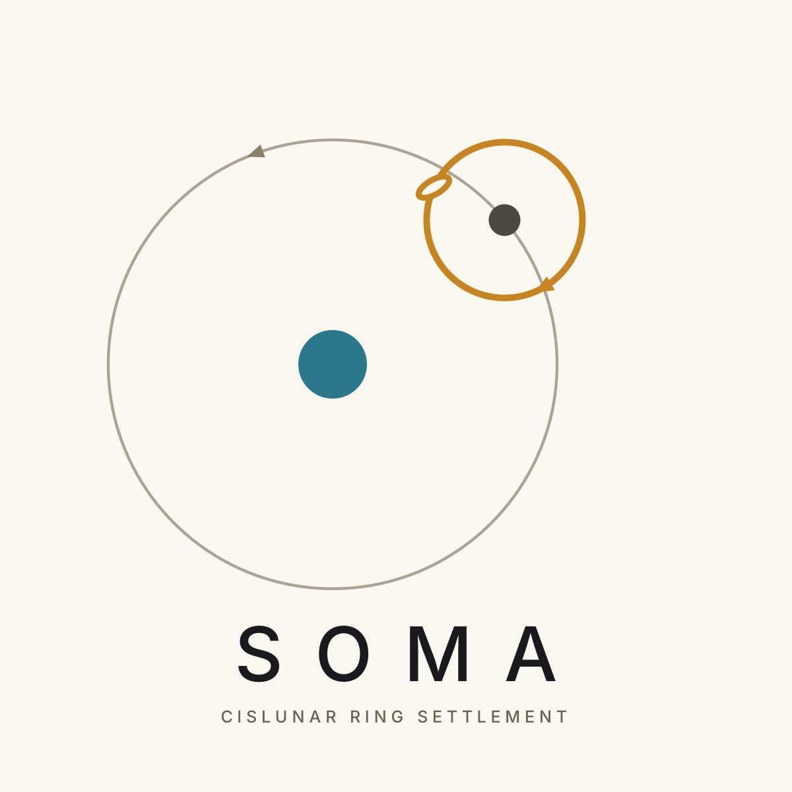
  </picture>
</p>

# Soma: Cislunar Ring Settlement

<p align="center">
  <a href="videos/soma-construction-film.mp4">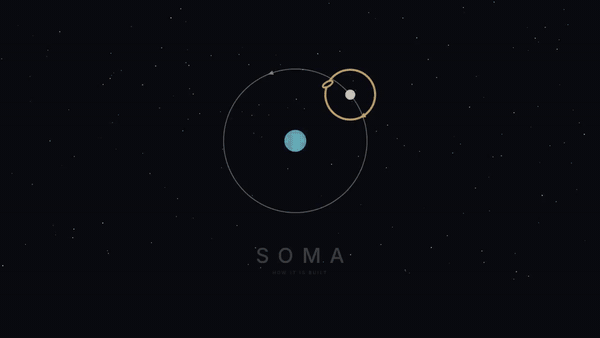</a>
  <br>
  <a href="videos/soma-construction-film.mp4"><b>▶ Watch the full film: How Soma is built (5 min 44 s)</b></a>
</p>

A speculative design study for space settlements: a cislunar ring for about 550,000 people, six of them stacked on one shared spine, built from Starship-sized hull units, lunar material and self-assembling bay factories, and parked in a stable orbit around the Moon. The study also sketches two Sun-orbiting rings (between Earth and Mars, and in the asteroid belt).

The logo is the orbit itself: the ring loops the Moon backwards every 4.7 days while the Moon carries it around Earth.

All figures are order-of-magnitude estimates for a concept, not engineering results.

## 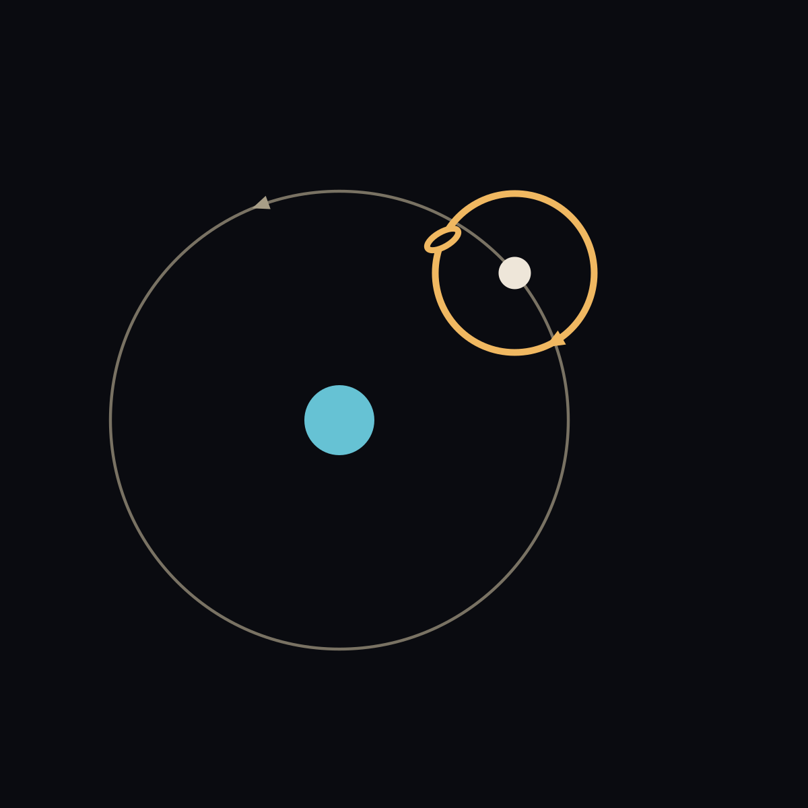 The film: how Soma is built

Every construction animation in build order, from the bay factory to the finished six-ring stack, ending with a zoom out to its orbit around the Moon (5 min 44 s). The highlights at the top of this page come from it; click either preview to open the MP4.

[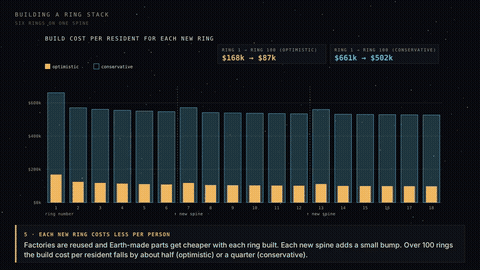](videos/soma-construction-film.mp4)
https://github.com/varunpra97/SomaCislunarSettlement/blob/main/videos/soma-construction-film.mp4


##  Construction, step by step

### 1 · The bay factory (66 s)
The hub Starship arrives, the work ring grows segment by segment, the gripper ring and beams go on, fit-out, then the inchworm cycle that moves the factory 18 m per bay.

[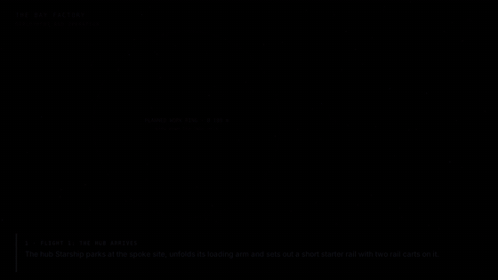](videos/bay-factory.mp4)

### 2 · The spine and centre pods (52 s)
A cargo Starship sets out the spine core; tug Starships latch onto its ends and steer it while extruders grow it to 14 km. Robot arms then build a 400 m centre pod (magnetic bearings, motor ring, spoke sockets) for each ring.

[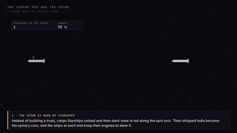](videos/centre-pod-and-spine.mp4)

### 3 · Spokes and the middle ring (48 s)
Six crawlers lay basalt-fibre spokes 17.35 km out in balanced pairs; small bay factories then close a 40 m middle ring at half radius (0.5 g).

[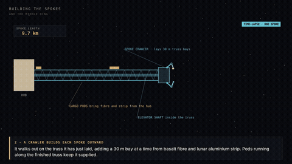](videos/spokes-and-middle-ring.mp4)

### 4 · Building the tube (57 s)
Robotic arms unload a Starship, close the ring frame, hang the hull panels, weld and leak-test one bay, then advance. The interactive version is in [`animation/ring-assembly.html`](animation/ring-assembly.html).

[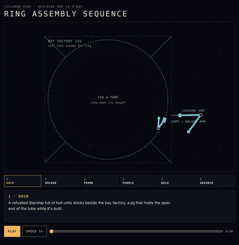](videos/ring-assembly.mp4)

### 5 · Solar wings and radiators (50 s)
Wing robots unroll 90 m blankets of lunar-made cells along each spoke (17 km², ~6 GW); fin carriers on the shield fit one 150 × 75 m radiator per cell (~650 in all).

[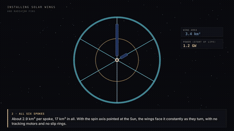](videos/solar-and-radiators.mp4)

### 6 · The ring stack (64 s)
Twin rings spin up against each other, the pair steers the stack to face the Sun like a giant gyroscope, two more pairs follow, and the build cost per resident falls with each new ring.

[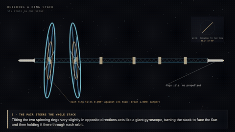](videos/ring-stack.mp4)

##  The orbit (58 s)

A lunar distant retrograde orbit ~30,000 km from the Moon. In a simplified Earth–Moon–Sun model it stayed bound for 20 years with no corrections, even with a 2 m/s kick each time a ring was added; larger loops (40,000–70,000 km) drifted off within a few years.

[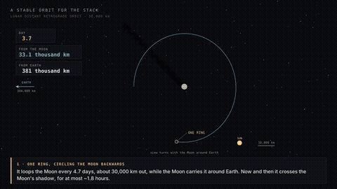](videos/stable-orbit.mp4)

##  Living there

### A day on the ring (91 s)
Dawn over a valley of terrace homes, a Roadster driving up a block's climb lane to its terrace, the commute, a spoke elevator to low gravity, the farm cells, the waterfront, the night market, life support at night, and the ring from outside.

[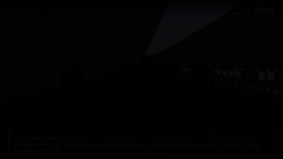](videos/day-on-the-ring.mp4)

##  Report

[**Soma: Cost, Deployment and Operations**](docs/soma-report.pdf) (PDF, 36 pages): proof-of-concept milestones, cost, deployment, building the spokes, wings and radiators, ring stacks and the price per resident for each new ring, the orbit, bootstrapping, power, heat, air, water, food and waste, and how the systems work together.

##  Design boards

| | |
|---|---|
| **The Chart of Settled Orbits**: the solar system with Helios Ring I (≈1.25 AU), Helios Ring II in the asteroid belt fed by Jupiter, and the cislunar rings. 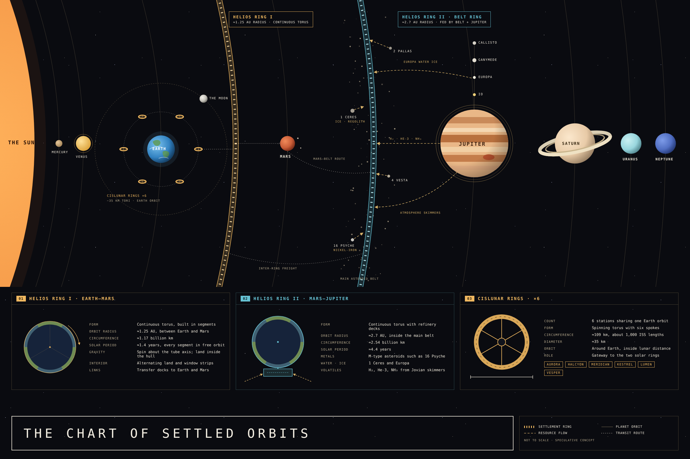 | **Cislunar Ring · Design Study**: 109 km ring, 150 m tube, static regolith shield, ~300 Mt bill of materials and where it comes from. 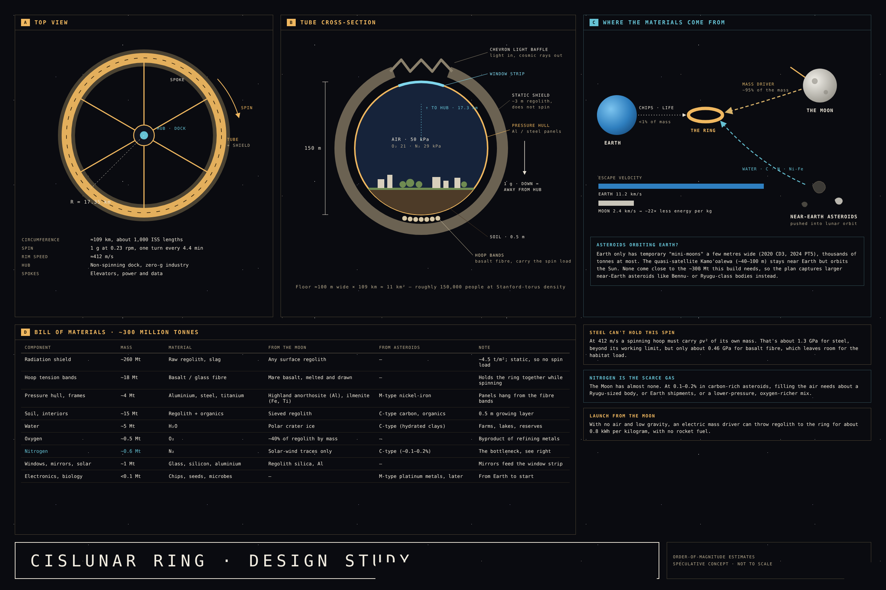 |
| **Starship Hull Units**: 84-panel cross-section, 16 panels per Starship, unit catalogue and robotic assembly of one bay. 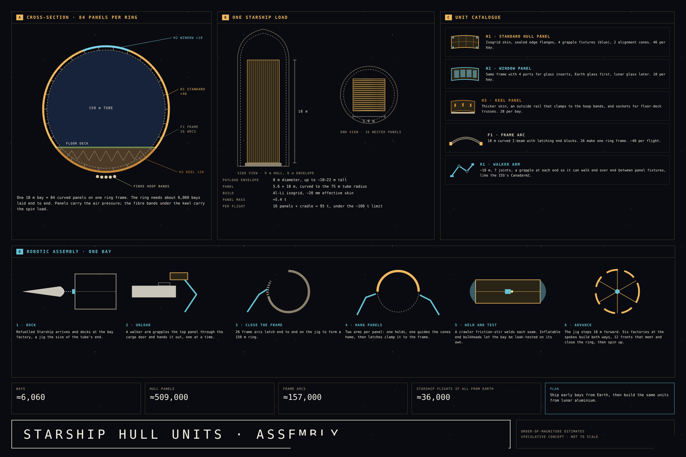 | **The Bay Factory**: two 180 m rail rings and telescoping beams, 7 Starship flights to deploy, self-assembly and the inchworm cycle. 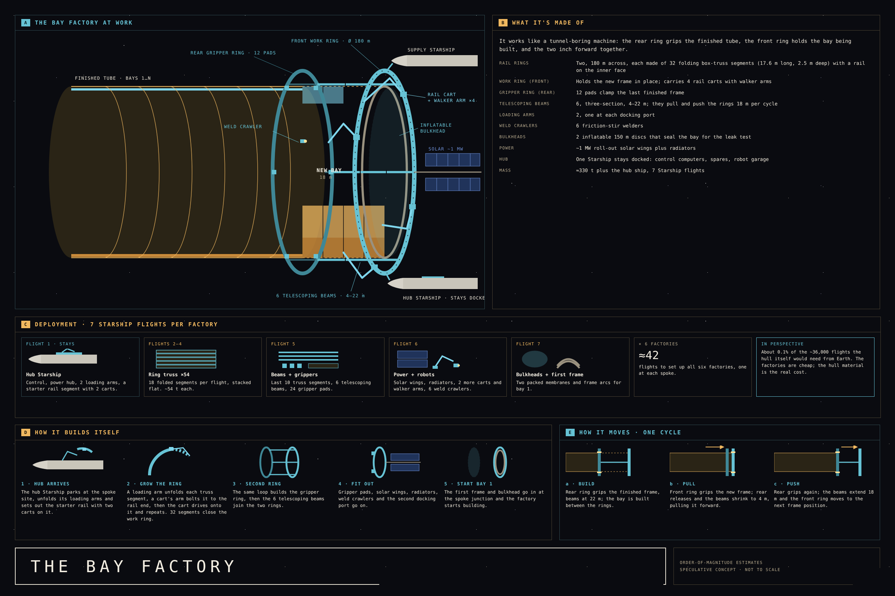 |
| **Settlement Cells**: 45 levels per cell, 11 cell types including leisure (great outdoors, waterfront, food and night, parks and sports), a 20-cell district, and the cell mix. 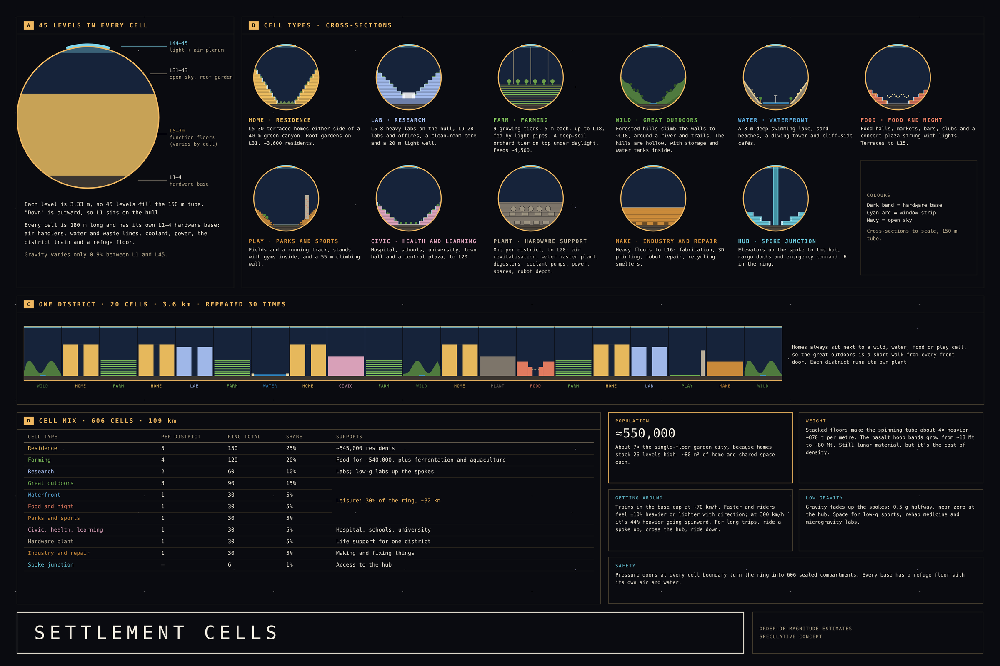 | **Life Support**: air, water, food and waste loops, lunar make-up, light, heat and power, and safety. 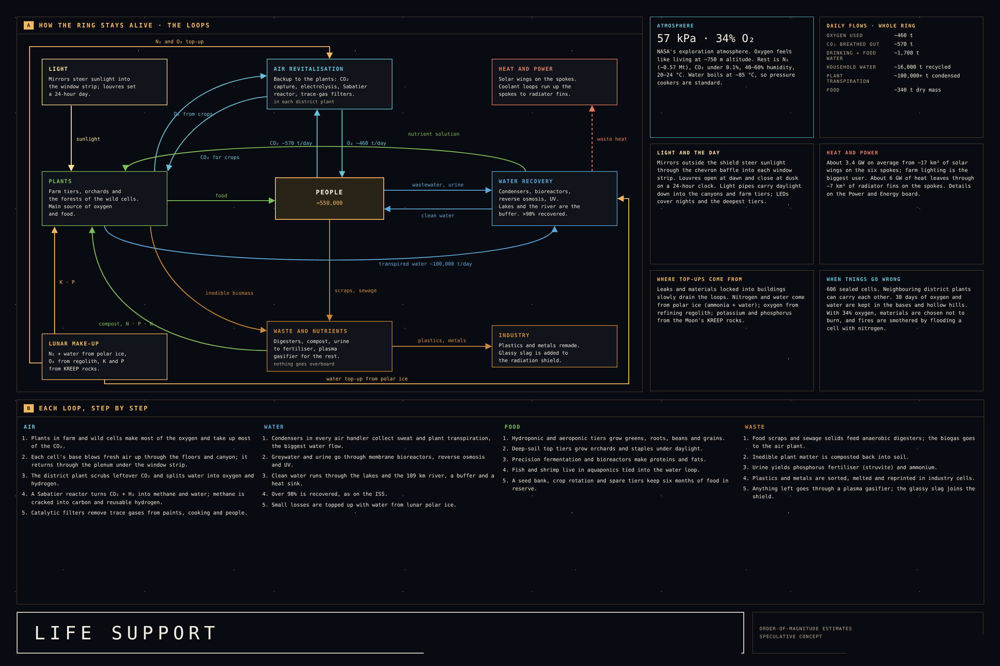 |
| **Landscape and Water**: hollow filter mountains and the district water loop. 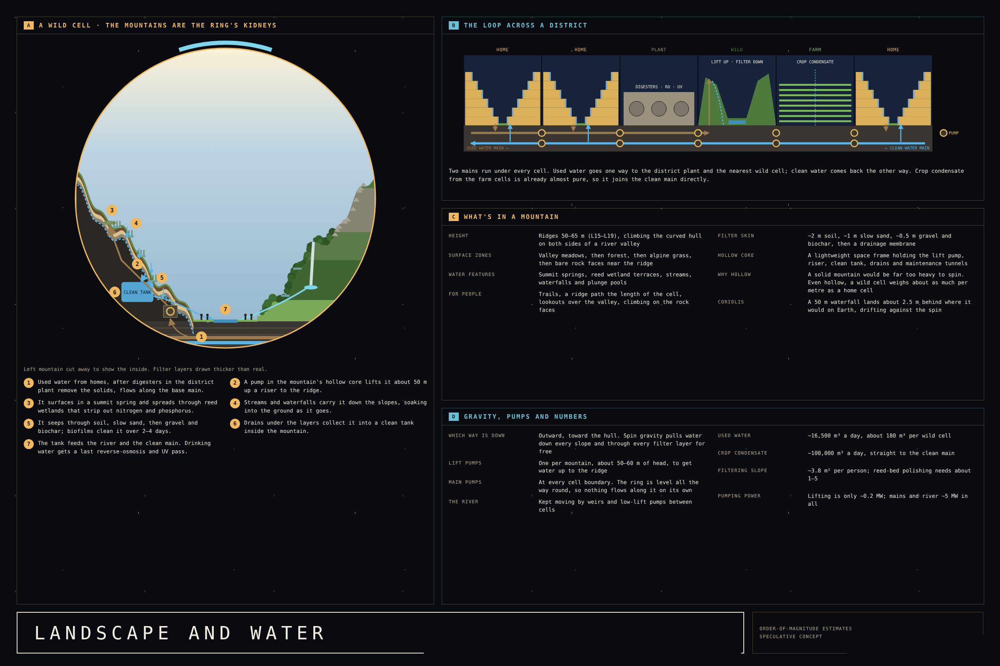 | **Power and Energy**: spoke solar wings, batteries, loads and air movement. 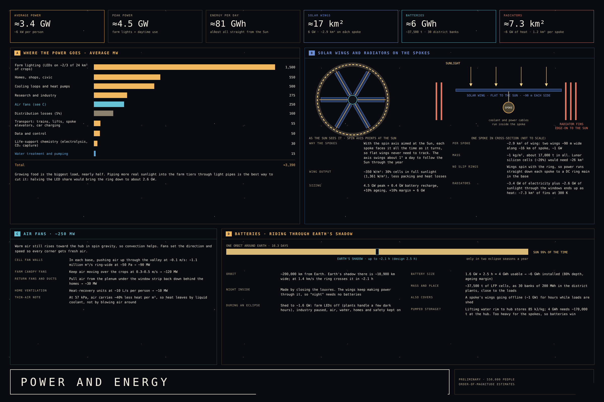 |

Full-size PNGs are in [`designs/png`](designs/png); standalone HTML versions are in [`designs/html`](designs/html).

##  Key numbers

| | |
|---|---|
| Ring | 109 km around, 17.35 km radius, 1 g at 0.23 rpm |
| Tube | 150 m across, 45 levels of 3.33 m, 606 cells of 180 m |
| Population | ≈550,000 per ring with stacked homes; ≈3.3 million in a six-ring stack |
| Atmosphere | 57 kPa, 34% O₂ (NASA exploration atmosphere) |
| Mass | ~300 Mt per ring, mostly lunar regolith; ~1 Mt spine for a six-ring stack |
| Middle ring | r 8.7 km, 0.5 g, Ø 40 m, ~0.5 Mt |
| Stack | 6 rings (3 counter-rotating pairs) on a 14 km spine, 2 km apart |
| Orbit | Lunar distant retrograde orbit, ~30,000 km from the Moon, 4.7-day loop |
| Cost per ring | ≈$89–356B standalone, with 100 rings sharing the lunar industry |
| Cost per resident | Ring 1: $168–661k → ring 100: $87–502k |

##  Logo

The logo files are in [`assets/logo`](assets/logo): full logo and mark alone, dark and light, as PNG and SVG.

| Dark | Light |
|---|---|
| 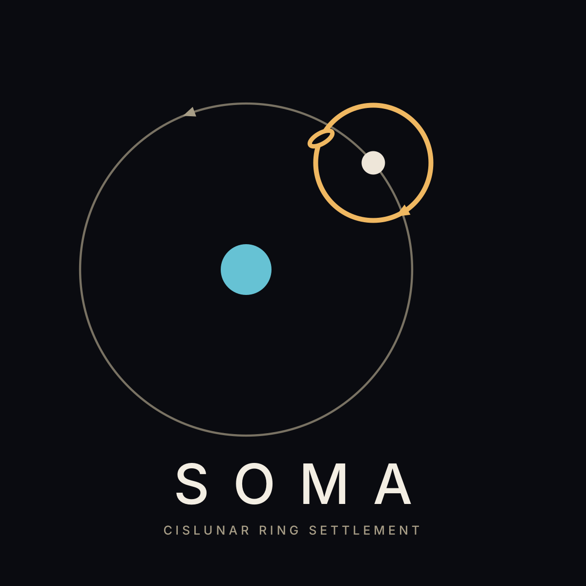 |  |

##  Repository layout

```
assets/logo/       Soma logo and mark (PNG + SVG, dark and light)
videos/            MP4 videos, including the full construction film
docs/              GIF previews used in this README, and the report PDF
designs/png/       board exports (2400 × 1600)
designs/html/      standalone board pages + SVG assets
animation/         interactive ring-assembly animation (HTML)
scripts/           Python (pycairo) scripts that render the videos, drawings and logo
scripts/stack/     spokes, solar/radiators, centre pod/spine, stack and orbit videos; cost and orbit models
scripts/film/      logo, title cards and the zoom-out finale
```

To re-render: `pip install pycairo numpy scipy`, have `ffmpeg` on the path, then run e.g. `python scripts/stack/stackvid.py all` or `python scripts/film/finale.py`. Each script writes one MP4 per scene and joins them with ffmpeg's concat demuxer.
